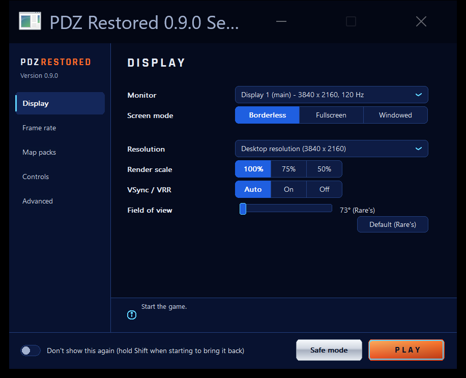

# Perfect Dark Zero Restored

Perfect Dark Zero Restored (PDZ Restored) is a native PC version of Rare's Xbox 360 launch game Perfect Dark Zero.

As well as bringing the game to PC, it restores two multiplayer modes Rare left unfinished, Plant the Flag and Protection, adds bots to Sabotage mode, and allows matches with up to 31 bots.

The game's own code, including Title Update 3, has been recompiled into a Windows program, and a native Direct3D 12
renderer draws the graphics. The game runs as native code, not in an emulator.

It is built on [nikolaygorb's PerfectDarkZeroRecomp](https://github.com/nikolaygorb/PerfectDarkZeroRecomp) and the
[ReXGlue SDK](https://github.com/rexglue/rexglue-sdk).

**This project contains no game files.** You need your own copy of the game.

AI was used to help with the game's code and settings window.

<div align="center">
  
</div>

## Download

Get the latest version from the
[Releases page](https://github.com/EddieVanHelgen/PerfectDarkZeroRestored/releases). Unzip it into its own folder
and read the `README.md` inside.

## What this project is about

PDZ Restored focuses on restoring Rare's original game rather than modernising it: finishing what Rare left unfinished, fixing its bugs and making it run well on PC.

Other projects take the game in different directions, and they're all well worth a look:
- [PerfectDarkZeroRecomp](https://github.com/nikolaygorb/PerfectDarkZeroRecomp) by nikolaygorb, the recompilation this project is built on, with its own enhancements such as a third-person camera.
- [Perfect Dark Zero: Reinstated](https://github.com/2023PerfectDark/Perfect-Dark-Zero-Reinstated) by 2023PerfectDark, which adds new content and options of its own.
- [Perfect Dark Zero Reworked](https://github.com/zerocoregithub/PerfectDarkZeroReworked) by zerocore, with controller, gyro, aiming and presentation enhancements.

## Features

- **Two cut multiplayer modes restored.** Rare left Plant the Flag and Protection modes unfinished. Both are now
  finished and playable, with bots.
- **Bots in Sabotage.** Sabotage on Xbox 360 shipped without bot support. After 85 commits and 70+ test runs, the bots can finally play the mode properly.
- **Up to 31 bots** in a match, and 32-player Infection. Bots can use turrets. Facility and Ruin stay 8-player maps,
  per Rare's original settings.
- Both official map packs can be imported from your own console. A known fault in some copies of Map Pack One is repaired when you install it. The US Platinum Hits disc already has them.
- A native Direct3D 12 renderer that matches the Xbox 360 graphics, up to 4K, with higher frame rates and much lower GPU use than emulated rendering.
- Up to 120 fps in the campaign, if your PC and screen support it. Multiplayer is locked at 60 fps.
- Built on Title Update 3, with all of Rare's tweaks and bug fixes.
- Dozens of additional bug fixes, including aiming, weapons, enemy AI, cover, missing speech and sounds, and menus.
- A music selector for multiplayer matches, and an option to play your own MP3s.
- A settings window with display, frame rate, map pack and control options, including a field of view slider.
- Safe mode - just in case.
- This release was primarily designed and tested using a controller. Mouse and Keyboard are supported and fully remappable.

## What you need

- Windows 10 or 11, 64-bit.
- A processor with AVX2: Intel 4th generation ("Haswell", 2013) or newer, or AMD Ryzen or newer.
- A graphics card that supports DirectX 12.
- The [Microsoft Visual C++ Redistributable (x64)](https://aka.ms/vs/17/release/vc_redist.x64.exe).
- Your own Perfect Dark Zero disc, as a disc image (`.iso`) or its extracted files. Any of the five original retail
  discs works, and so does the US Platinum Hits disc (see below).
- Title Update 3 for Perfect Dark Zero, copied from your own Xbox 360. Any disc's Title Update 3 works. The US
  Platinum Hits disc doesn't need it.
- Optional: the two official map packs, copied from your own Xbox 360.

No game files are included, and none can be downloaded through PDZ Restored.

## Setting it up

1. Unzip the release into its own folder, for example `C:\Games\PDZRestored`.
2. Put your disc image (or the extracted disc) and the Title Update 3 file into the `game` folder.
3. Start `PDZRestored.exe`. The first start checks your files and prepares them. This takes about 20 seconds.
4. The settings window opens. Add your map packs on the Map packs tab if you have them, then press Play.

### US Platinum Hits

The US Platinum Hits disc works as it is:

1. Put its disc image (`.iso`), or the extracted disc, into the `game` folder.
2. You don't need Title Update 3. If one is in the `game` folder, it isn't used for this disc.
3. Both map packs are already on this disc. The Map packs tab shows them as included; there's nothing to add there.

## Status

Status: 0.9.3.1 is the current release (November 2026). It's playable from start to finish; see the release notes for what's new. So far it has been tested on one PC with NVIDIA GPU.

Reports from other PCs are very welcome, especially with AMD or Intel graphics cards or older processors. Please
[open an issue](https://github.com/EddieVanHelgen/PerfectDarkZeroRestored/issues) and attach the newest log from
the `logs` folder next to `PDZRestored.exe`. The settings window's Advanced tab has a button that opens it.

Known issues are listed in the release's `README.md` ([tools/release/README.md](tools/release/README.md)).

## What's next

Being explored for future versions:

- **Duel and Team Duel**, another multiplayer mode Rare left unfinished.
- **Round-based Eradication**, a cut version of Eradication that is still in the game's code.
- **Artefact**, a carry-the-item mode Rare cut early. Only its announcer lines survive, so it would have to be
  rebuilt.
- **Online play** with friends over the internet.

## Building from source

This part is for developers. Players only need the release zip.

### Requirements

- Windows 10 or 11, 64-bit. The Linux and macOS CMake presets come from upstream and are not tested here.
- CMake 3.25 or newer, Ninja, and Clang/LLVM. MSVC alone won't build it. Build from a Visual Studio developer
  command prompt so Clang finds the Windows SDK.
- Python 3, for the scripts in `tools/`.
- The game's files, extracted from your own disc, to recompile from:
  - `assets/default.xex` and the rest of the disc (`assets/pdz/...`).
    [extract-xiso](https://github.com/XboxDev/extract-xiso/releases) can extract a disc image.
  - Title Update 3's `default.xexp`, as `assets/default.xexp`. The code generator applies it.

  The code in this repository is generated from media ID `6A78E206` (`default.xex` SHA-1
  `c24ae39fb18a22de1f18e61dc498393d25eadcaf`) and its Title Update 3 (`TU_16L61UJ_000000G000000.00000000000O4`,
  `default.xexp` SHA-1 `b148ab898498a4dbdd494ddaf0e7d826612a6126`). Every disc and Title Update 3 pairing gives
  the same patched program, see [docs/RELEASE_FIRST_RUN.md](docs/RELEASE_FIRST_RUN.md). `assets/` is gitignored
  apart from its README and icon.

### Build

1. Clone the repository with its submodules. The ReXGlue SDK is built from source in `thirdparty/rexglue-sdk`.

   ```
   git clone --recursive https://github.com/EddieVanHelgen/PerfectDarkZeroRestored.git
   ```

   If you cloned without `--recursive`, run `git submodule update --init --recursive`.
2. Put the game's files into `assets/` as described above.
3. Configure and build:

   ```
   cmake --preset win-amd64-release-v3lto
   cmake --build --preset win-amd64-release-v3lto
   ```

   The code generator runs as part of the build and writes `generated/`.
   - `win-amd64-release-v3lto`: AVX2 (x86-64-v3) with ThinLTO, like the release.
   - `win-amd64-release-v3`: the same without LTO, so it links faster.
   - `win-amd64-release`: for any x86-64 processor.

   The release is also built with profile-guided optimisation (`win-amd64-release-pgousev3`). That needs a local
   `.profdata` profile of your own.

Title Update 3 removed the interactive (stealth / action) music. This build can restore it from
`src/music/music_lifted.inc`, which `tools/lift_music.py` makes from your own launch version of the game. That file
is not in the repository. Without it, the build plays Title Update 3's music.

### Run

```
out\build\win-amd64-release-v3lto\PDZRestored.exe
```

- Game files are read from `<repo>\assets`, found by searching upwards from the exe. `--game_data_root` points
  somewhere else.
- Title Update 3's data files are read from `Documents\perfectdarkzerorecomp-tu3\update`
  (`update\Pdz\Assets\PackageData\1726605008.pkg` must exist). `--update_data_root` points somewhere else.
- If the files aren't found there, the exe runs the release's first-run setup instead: it looks in `game\` next to
  the exe and prepares the files in `data\`.
- Saves and the shader cache are in `Documents\perfectdarkzerorecomp-tu3`.
- Logs are written to `logs\` next to the exe, as `PDZRestored_NNN.log`.
- `tools/release/stage_release.py` makes the release folder and zip. It refuses game files, translated shaders,
  audio, and Microsoft files other than `dxcompiler.dll` and `dxil.dll`.

### Settings and documentation

- The settings are in [`settings/`](settings/README.md) and are read at start-up. `hardware.toml` covers the
  renderer, window, frame rate, fixes and options. `mapping.toml` covers the keyboard and mouse. The settings window
  (hold Shift while starting) writes some of them. The release ships `settings/release/hardware.toml`.
- Confirmed bug fixes are on by default. Most enhancements are off unless the release settings turn them on.
  What each fix does and why: [docs/BUG_AUDIT.md](docs/BUG_AUDIT.md) and [src/mod/README.md](src/mod/README.md).
- More notes: [docs/MAP_PACKS.md](docs/MAP_PACKS.md), [docs/MOUSE_KEYBOARD.md](docs/MOUSE_KEYBOARD.md),
  [docs/MP_MUSIC_CUSTOM.md](docs/MP_MUSIC_CUSTOM.md), [docs/MULTIPLAYER_GUIDE.md](docs/MULTIPLAYER_GUIDE.md),
  [docs/RELEASE_FIRST_RUN.md](docs/RELEASE_FIRST_RUN.md), [docs/RELEASE_SHADERS.md](docs/RELEASE_SHADERS.md),
  [docs/SETTINGS_WINDOW.md](docs/SETTINGS_WINDOW.md).

## Credits

- **Rare**, who made Perfect Dark Zero.
- **nikolaygorb**, for [PerfectDarkZeroRecomp](https://github.com/nikolaygorb/PerfectDarkZeroRecomp), the
  recompilation this project grew from (MIT licence), and **2023PerfectDark** for its local profile manager.
- The **[ReXGlue SDK](https://github.com/rexglue/rexglue-sdk)** and its authors. Its runtime is derived from
  [Xenia](https://github.com/xenia-project/xenia).
- **[XenosRecomp](https://github.com/hedge-dev/XenosRecomp)** by hedge-dev, the shader translator built into
  PDZ Restored.
- **Perfect Dark Zero: Reinstated** (2023PerfectDark / PerfectDark023), for finding that Rare's physics step is a
  fixed 1/60 s.
- **[xenia-canary/game-patches](https://github.com/xenia-canary/game-patches)**, where the 60 fps and 16:9 patches
  come from.
- The authors of the other libraries, listed with their licences in [THIRD_PARTY_NOTICES.md](THIRD_PARTY_NOTICES.md)
  and [docs/CREDITS.md](docs/CREDITS.md).

PDZ Restored is an unofficial fan project. Perfect Dark Zero belongs to Rare and Microsoft, and this project is not
made, approved or supported by them.

PDZ Restored was made with a lot of help from Claude (Anthropic's AI assistant).

Made by a fan, out of love for Perfect Dark Zero and respect for the people at Rare who made it.

## Licence

MIT, see [LICENSE](LICENSE). It covers this project's own code only, not the game or its assets.
